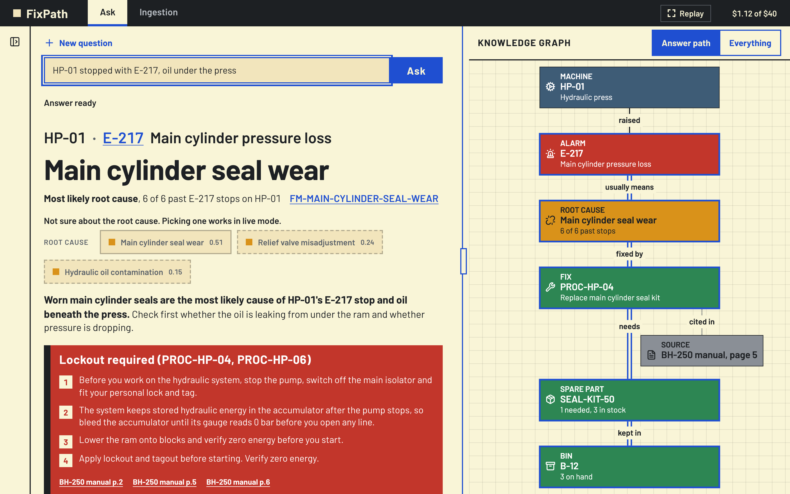
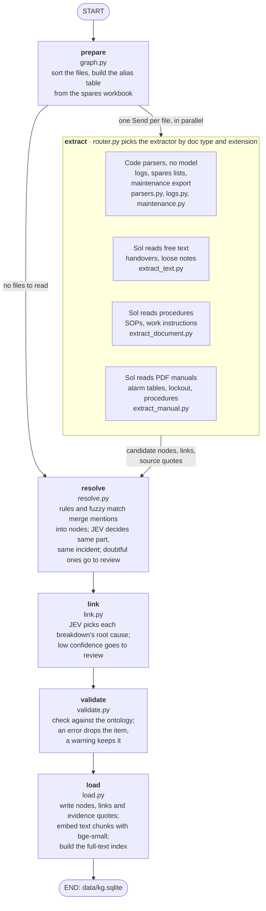
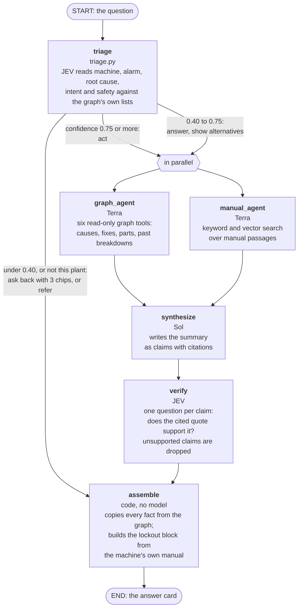

# FixPath

Every answer shows its source and the graph path behind it.A troubleshooting assistant for factory technicians.

## What it does

1. **Builds a graph from a messy folder:** Multiple files are ingested and turned into a knowledge graph. Every node and link keeps its source quote, page and confidence.
2. **Answers a technician in plain language:** User reads the question, finds the likely cause, the fix steps, the parts with stock and bin, and similar past breakdowns, and cites a source for each.

## Architecture

| Part | What it is |
|---|---|
| Ingestion crew | A router sends each file to an extractor, then a resolver, a linker, a validator and a loader.  |
| Troubleshooting crew | Triage, graph agent and manual agent in parallel, a synthesizer, a verifier and a code step that assembles the card. |
| System 1 | JEV makes fast decisions (route, merge, link, verify). OpenAI Decisions API is fallback. |
| System 2 | Sol runs extraction and synthesis. Terra runs the graph agent, manual agent and eval judge. |
| Database | One SQLite file: nodes, links, evidence quotes, text chunks with local embeddings, and a full-text index. |
| Caches | Every model and decision answer is cached. |
| Web app | React, TypeScript and Vite on bun. FastAPI streams answers as server-sent events. |

Each box below is a node in the compiled LangGraph, with the file that holds it. Ingestion is wired in `src/app/ingest/graph.py` (`build_graph`) and the troubleshooting crew in `src/app/ask/crew.py`.

The ontology has nine node types and twelve relations, defined once in `src/app/ontology.py` and exported for the web app.

## Setup

Requires uv, Python 3.13 and bun.

    make setup
    cd web && bun install
    make test

The first run embeds text and needs network once, to fetch the embedding model into cache. 

## Run it with cached model

The cache answers the six suggested questions and show the whole graph, so no key is needed.

    make api-replay      # terminal 1, the API on port 8000
    make web             # terminal 2, the web app on port 5173

Or it can be run with a single command that runs both using concurrently.

    make offline         # terminal 1, both API and web app on ports 8000 and 5173

- With no OpenAI key the API never makes a paid call, whatever else is set. 
- Open `http://localhost:5173`. 

## Run it live

Copy `.env.example` to `.env` and fill in the keys you have. `.env` is not committed.

| Variable | Used for |
|---|---|
| `OPENAI_API_KEY` | Sol, Terra and the OpenAI Decisions backend |
| `TYPESAFE_API_KEY` | JEV |
| `DECIDER` | `auto` (JEV when its key is set, else Decisions), `jev` or `decisions` |
| `BUDGET_USD` | The hard stop for model spend. The default is 40. |
| `LANGFUSE_*` | Optional tracing. It turns on only when the keys are set. |

    make live            # the API and the web app together, both live

- All questions now run through the full pipeline, and any file can be dropped on the Ingestion view.

- With keys in `.env`:  `make ingest`, `make evals`, `make warm`, `make api` and `make live` can make paid calls. 
- Every one of them stops at `BUDGET_USD`, and a call that is already cached costs nothing. 
- `make api-replay` and `make offline` never cost.

## Make targets

| Target | What it does |
|---|---|
| `make setup` | Install the Python packages with uv |
| `make test` | Run the Python tests |
| `make data` | Generate the simulated plant data from a fixed seed |
| `make ingest` | Rebuild the graph from `data/raw` |
| `make api`, `make api-replay` | Serve the API live, or keyless from the caches |
| `make offline` | Run the replay API and the web app together, with no keys |
| `make live` | Run the live API and the web app together. It needs `OPENAI_API_KEY` and `TYPESAFE_API_KEY` |
| `make map` | Rebuild the 3D fact map. It needs the optional `map` dependency group |
| `make testset` | Generate the ten extra ingest files and five validation files in `data/testset` |
| `make warm` | Run the suggested questions once with keys, to refresh the caches |
| `make web`, `make web-build` | Run the web app, or build it |
| `make golden` | Make the golden question sets |
| `make evals` | Run the five eval layers and the bake-off |
| `make ontology` | Export `config/ontology.json` for the web app |
| `make brand`, `make brand-check` | Fill the deck from `config/brand.json`, or check the name stays in that one file |
| `make deck` | Build the diagrams and `docs/deck/deck.pdf`. It needs Chrome for Testing (set `DECK_BROWSER` to use another browser) and the network once, for `bunx`. |
| `make deck-private` | Build a copy of the deck with one extra line on the title slide, read from `docs/private/audience.txt` |

## The simulated data

`make data` writes the same plant every time from a fixed seed. The generator first builds a true world over six months. It then renders that world into `data/raw/` as messy files:

The true world is written to `data/truth/`. Only the generator writes there, and only the evals and the tests read it. A test fails if the pipeline imports it.

## Evals

- 5 layers measure the system against the hidden truth, and there is a comparison between the two decision backends. 
- Results are in `data/evals/results/latest.json`.

| What | Result |
|---|---|
| Lockout recall | 19 of 19 fixes that need lockout |
| Root cause, top 1 | 20 of 20 questions |
| Traps passed | 5 of 5 |
| Triage, all five fields | 22 of 22 on questions it acted on (29 of 32 on all 32) |
| Citation precision | 96 of 102 kept claims |
| JEV against Decisions | Comparable accuracy. JEV is cheaper per 1,000 asks and faster at the median. |

Read these with their limits:

- The golden questions re-ask recorded incidents, so they are not hold-out results.
- Over-warning and the safety false-positive rate each rest on one negative case.
- Live latency and cost were measured before the last code-only fixes.
- The gates and prompts were tuned on JEV, and the best gate of each backend is chosen on the questions it is scored on, so the bake-off flatters both.

## Repository layout

| Path | Holds |
|---|---|
| `src/app/generator/` | The seeded plant data generator |
| `src/app/ingest/` | The ingestion crew |
| `src/app/ask/` | The troubleshooting crew |
| `src/app/decide/` | The JEV and Decisions backends behind one interface |
| `src/app/api/` | The FastAPI app and its event streams |
| `src/app/evals/` | The five eval layers and the bake-off |
| `src/app/ontology.py` | The single source for types, links, labels, glyphs and colours |
| `web/` | The web app |
| `config/` | The product name and the exported ontology |
| `data/` | The raw files, the graph, the pipeline report, the truth, the caches, the golden sets, the eval results and recorded API responses |
| `docs/` | The deck, the demo script, the diagrams and the images |
| `scripts/` | The name check and the deck build |
| `tests/` | The Python tests |
